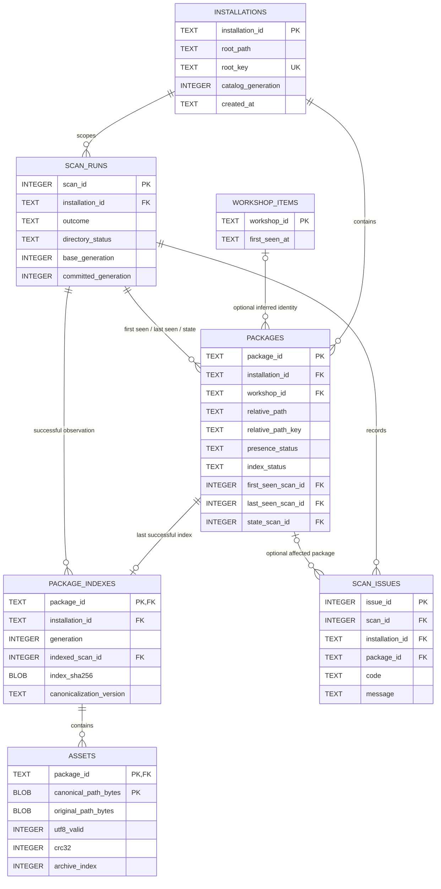

# M3 SQLite schema proposal — Revision 2 approved and implemented

Implementation status, 29 October 2026: the owner approved Revision 2. M3 now
implements this exact DDL; see README, DECISIONS and TEST_RESULTS. The separate
fictional demo is available at `examples/m3-demo/m3_demo.sqlite3`. Statements below
about waiting, proposed behavior and unexecuted SQL preserve the **pre-approval
review record**, not the current implementation status. No later milestone is
authorized by this approval.

Prepared 26 October 2026. **Original design-review status: no schema has been executed, no database
has been created, and no M3 application code has been implemented.** The owner
explicitly requires approval of this proposal before implementation.

Revision 2 adds the complete [fictional dataset](M3_SAMPLE_DATA.md) and
[future UI data contract](UI_DATA_PRESENTATION_CONTRACT.md). The seven M3 tables,
columns, keys and SQL DDL remain unchanged. This revision resolves audit frequency,
exact location-key behavior and the effects of soft deletion on future user data.

This proposal follows the supplied v1.0 product/technical documents under
`Handoffs/v1.0/` and the accepted M2 review decisions. Proposed scope: SQLite
persistence for discovery, package identity, last valid asset indexes, scan audit
and safe reconciliation. No conflict analysis, classification, overrides,
planning features, UI or game-state reader is included.

## 1. Design in plain language

Keep three identities separate:

- **Installation scope:** one explicitly selected canonical root namespace.
- **Package UUID:** the app's stable identity for a continuously tracked package.
- **Workshop ID:** an optional numeric filename hint; it is not the package key
  or proof of subscription identity.

The latest observed file metadata belongs to `packages`. The last successfully
parsed metadata belongs to `package_indexes` and `assets`. They can describe
different file versions when an update is corrupt, unfinished or inaccessible.
That separation prevents a failed scan from destroying the last valid index.

Seven tables are proposed for M3. Future-feature tables are shown separately and
will not be created in M3. The active collection excludes confirmed-removal rows,
but those rows and their last valid indexes remain retained for safe history and
future edit ownership. M3 retains **one last valid index per package**, not every
historical asset revision.

## 2. M3 Entity Relationship Diagram



Cardinalities:

| Relationship | Cardinality and optionality |
| --- | --- |
| Installation → packages | 1:M; each package has exactly one installation scope |
| Installation → scan runs | 1:M; each run scans one explicitly selected scope |
| Workshop item → packages | 1:M; each package has zero or one inferred item; an item may have no retained packages or several |
| Scan run → packages | Three separate 1:M roles: first seen, last seen and latest state transition |
| Package → last successful index | 1:0..1; a new/broken package can have no valid index |
| Scan run → successful indexes | 1:M; an index references the scan that produced its retained data |
| Successful index → assets | 1:M, including zero assets for a valid empty directory archive |
| Scan run → issues | 1:M, including zero issues |
| Package → issues | 1:M; an issue can instead be folder-level or pre-identity and have no package |

No M:N relationship requires a junction table in M3. `assets` is a child resource
listing, not a global resource dictionary or an implemented conflict graph.
Composite FKs below enforce installation scoping as well as entity existence.

## 3. Column conventions and keys

- UUIDs are application-generated UUID4 values stored as 32 lowercase hexadecimal
  characters in `TEXT`. They never derive from a path, Workshop ID or content hash.
  The repository validates UUID format. SQL requires non-null unique keys.
- Scan/issue IDs are database-local `INTEGER PRIMARY KEY` values. SQLite supplies
  them when omitted; no `AUTOINCREMENT` keyword is needed for this retained audit.
- Times use UTC ISO 8601 `TEXT`, e.g. `2026-10-26T08:30:00.000000Z`. A common
  fixed format is validated by the repository. File mtime/ctime are integer
  nanoseconds, preserving M2 metadata rather than converting to floating point.
- File device/identity numbers use canonical decimal `TEXT`: Windows identities
  can exceed SQLite's signed 64-bit integer range. They are observation hints,
  not durable primary keys. Sizes/modes/attributes and VPK unsigned 32-bit fields
  fit the intended signed 64-bit integer storage.
- SQL `NULL` means unknown/not available, never a fabricated ID or the text
  `Unknown`. SQL `CHECK` supplies ranges/enums; security/path/format validation
  remains in the application. The database does not grant filesystem access.
- `STRICT` tables provide type enforcement. Runtime must support SQLite 3.37+;
  the current environment reports **3.50.4**. No DDL was executed to check that.

A **candidate key** is a minimal unique identifier. A PK is the chosen candidate
key; alternate candidate keys can be protected by `UNIQUE`. Composite unique
constraints that include an already unique PK are **superkeys**, not additional
minimal candidate keys. We use two such superkeys to enforce scoped FKs.

### 3.1 `installations` — explicitly selected root namespaces

| Columns | Type / nullability | Purpose / key |
| --- | --- | --- |
| `installation_id` | TEXT NOT NULL | Stable UUID, PK |
| `root_path` | TEXT NOT NULL | Validated canonical absolute root for display |
| `root_key` | TEXT NOT NULL | Canonical Windows root comparison key, UNIQUE alternate key |
| `catalog_generation` | INTEGER NOT NULL | Commit sequence used to reject outdated concurrent scan results |
| `created_at` | TEXT NOT NULL | Registration timestamp |

Index: automatic PK and unique `root_key`. A stored root is not authorization to
scan it automatically; the CLI continues to require explicit root selection.
This is a path namespace, not proof of an authentic or physically immutable game
installation. Moving the selected root creates a different namespace unless a
future explicit migration is designed.

### 3.2 `workshop_items` — logical inferred Workshop identifiers

| Columns | Type / nullability | Purpose / key |
| --- | --- | --- |
| `workshop_id` | TEXT NOT NULL | PK; exact ASCII numeric stem, including leading zeroes |
| `first_seen_at` | TEXT NOT NULL | When this identifier entered the local registry |

The numeric string is the only candidate key. There is no fetched title,
subscription flag or fake metadata. Nonnumeric VPKs simply have a null FK in
`packages`. The separate table leaves room for later reviewed item metadata.

### 3.3 `scan_runs` — reconciliation audit and concurrency boundary

| Columns | Type / nullability | Purpose / key |
| --- | --- | --- |
| `scan_id` | INTEGER PK | Local audit identity |
| `installation_id` | TEXT NOT NULL | FK to installation |
| `started_at` | TEXT NOT NULL | Scan start |
| `finished_at` | TEXT NULL | Null until the attempt finishes |
| `outcome` | TEXT NOT NULL | `started`, `committed`, `failed`, `interrupted`, `superseded` |
| `directory_status` | TEXT NULL | M2 complete/missing/partial/unavailable/rejected; null before observation |
| `base_generation` | INTEGER NOT NULL | Catalog generation read before filesystem work |
| `committed_generation` | INTEGER NULL | Generation published by a successful commit |

Unique superkey `(installation_id, scan_id)` supports child composite FKs. Index
`(installation_id, started_at, scan_id)` supports scoped chronological audit.
`committed` means an atomic database batch was published; it does not mean every
package parsed or that directory enumeration was complete. Those facts remain
separate. After a crash, a `started` row means **completion unconfirmed**, not a
claim that its process is still alive. No catalog changes depend on that row
until the final transaction commits.

### 3.4 `packages` — durable identity, physical location and current observations

| Columns | Type / nullability | Purpose / key |
| --- | --- | --- |
| `package_id` | TEXT NOT NULL | Stable internal UUID, PK |
| `installation_id` | TEXT NOT NULL | FK to installation |
| `workshop_id` | TEXT NULL | Optional FK to inferred Workshop item |
| `relative_path` | TEXT NOT NULL | Original allowed physical VPK location |
| `relative_path_key` | TEXT NOT NULL | M2 casefold location key, scoped by installation |
| `presence_status` | TEXT NOT NULL | `present`, `missing_pending`, `unavailable`, `removed` |
| `index_status` | TEXT NOT NULL | `pending`, `current`, `error`, `unavailable` |
| `observed_device_id`, `observed_file_id` | TEXT NOT NULL, each | Latest safely observed OS identity numbers |
| `observed_mode`, `observed_attributes` | INTEGER NOT NULL, each | Latest metadata flags |
| `observed_size_bytes` | INTEGER NOT NULL | Latest observed physical size |
| `observed_mtime_ns`, `observed_ctime_ns` | INTEGER NOT NULL, each | Latest observed source times |
| `preview_relative_path` | TEXT NULL | Last safely associated same-stem JPG reference |
| `preview_status` | TEXT NOT NULL | `present`, `missing`, `unknown`; unknown can retain an older path |
| `first_seen_scan_id` | INTEGER NOT NULL | Scoped FK: first discovery of this UUID |
| `last_seen_scan_id` | INTEGER NOT NULL | Scoped FK: last durably recorded positive observation, not every poll |
| `state_scan_id` | INTEGER NOT NULL | Scoped FK: scan publishing the current status |
| `removed_at` | TEXT NULL | Set only on confirmed removal; inactive rows stay retained |

Only `package_id` is a global candidate key. A **partial unique index** enforces
one nonremoved package at `(installation_id, relative_path_key)`. This is a
conditional location key, not a globally unique package identity. Removed history
can contain earlier packages at that same location. `workshop_id` is not UNIQUE:
do not merge distinct physical packages merely because IDs match.

Unique superkey `(installation_id, package_id)` supports scoped child FKs.
Additional indexes: Workshop ID; installation/presence/index status; each scoped
scan FK. SQLite does not automatically add every useful child-FK index.

Presence and index validity are separate: an existing corrupt VPK is `present`
with `error`, while a prior index can still be retained. A missing preview is
confirmed only by completed appropriate enumeration; partial scans retain the
previous preview path as `unknown` rather than deleting it.

### 3.5 `package_indexes` — one last valid index per package

| Columns | Type / nullability | Purpose / key |
| --- | --- | --- |
| `package_id` | TEXT NOT NULL | PK; scoped FK to package using installation ID |
| `installation_id` | TEXT NOT NULL | Scope guard for package/scan composite FKs |
| `generation` | INTEGER NOT NULL | Monotonic successful-index revision within the package |
| `indexed_scan_id` | INTEGER NOT NULL | Scoped FK to successful producing scan |
| `vpk_version` | INTEGER NOT NULL | 1 or 2 |
| `tree_size` | INTEGER NOT NULL | Declared bounded tree size |
| `index_sha256` | BLOB NOT NULL | Exactly 32 digest bytes, header/tree only |
| `parser_version` | TEXT NOT NULL | Parser data-contract version for cache invalidation |
| `canonicalization_version` | TEXT NOT NULL | Version of comparison-key policy |
| `source_device_id`, `source_file_id` | TEXT NOT NULL, each | OS identities when this index succeeded |
| `source_mode`, `source_attributes` | INTEGER NOT NULL, each | Flags when indexing succeeded |
| `source_size_bytes` | INTEGER NOT NULL | File size when indexing succeeded |
| `source_mtime_ns`, `source_ctime_ns` | INTEGER NOT NULL, each | Source times when indexing succeeded |

Candidate key: `package_id`; 1:0..1 with packages. An index on
`(installation_id, indexed_scan_id)` supports its scoped scan FK.
The two metadata sets are different facts at different observations: changing
`observed_*` must not overwrite the old successful `source_*` on a failed update.
Do not persist arrays of external archive indices: they are derived from asset
rows. Asset counts, non-UTF-8 counts and stale status are likewise derived.

### 3.6 `assets` — byte-preserving resources in that retained index

| Columns | Type / nullability | Purpose / key |
| --- | --- | --- |
| `package_id` | TEXT NOT NULL | FK to retained index; part of composite PK |
| `canonical_path_bytes` | BLOB NOT NULL | Other part of PK; exact canonical byte key |
| `original_path_bytes` | BLOB NOT NULL | Original reconstructed virtual-path spelling/bytes |
| `utf8_valid` | INTEGER NOT NULL | Validated 0/1 flag; no guessed codepage |
| `crc32` | INTEGER NOT NULL | Declared unsigned CRC value; not payload validation |
| `preload_bytes` | INTEGER NOT NULL | Declared preload length |
| `archive_index` | INTEGER NOT NULL | Embedded or external reference identifier |
| `archive_offset`, `archive_length` | INTEGER NOT NULL, each | Declared asset range metadata |

PK/candidate key: `(package_id, canonical_path_bytes)`. Alternate candidate key:
`(package_id, original_path_bytes)`, enforced UNIQUE. Paths alone are deliberately
not unique across packages. Index `(canonical_path_bytes, package_id)` prepares
efficient later comparisons without implementing conflict analysis.

Use `STRICT, WITHOUT ROWID` for this composite-key table. BLOBs are bound as
Python `bytes`; never decode with `replace` or cast unknown bytes to SQLite TEXT.
SQL byte comparison uses the already generated key, not `COLLATE NOCASE`. Human
display is decoded reversibly and JSON-escaped in Python. Unknown encoding and
engine comparison semantics remain explicit limitations.

### 3.7 `scan_issues` — fixed, safe diagnostics

| Columns | Type / nullability | Purpose / key |
| --- | --- | --- |
| `issue_id` | INTEGER PK | Individual audit issue |
| `installation_id` | TEXT NOT NULL | Scope guard |
| `scan_id` | INTEGER NOT NULL | Scoped FK to run |
| `package_id` | TEXT NULL | Optional scoped FK; folder/pre-identity failures can be null |
| `relative_path` | TEXT NULL | Relevant allowlisted relative location, when known |
| `severity` | TEXT NOT NULL | `warning` or `error` |
| `code`, `message` | TEXT NOT NULL, each | Fixed diagnostics, not arbitrary OS exception/path dumps |

Only `issue_id` is a candidate key. Repeated issues across attempts are legitimate.
Indexes `(scan_id, issue_id)` and `(package_id, scan_id)` support audit/FK queries.
The nullable package FK is intentional; a folder access failure must be recordable
without inventing a package. A warning does not imply index failure.

## 4. Proposed SQL — inspect only, not executed

Connection policy: `foreign_keys=ON` on **every** connection, `busy_timeout=5000`,
`synchronous=FULL`, and `temp_store=MEMORY`. Use WAL for the designated app-owned
database; WAL/SHM files remain beside it. Check PRAGMA results; never silently
fall back to unsafe paths or weaker assumptions. Foreign-key enforcement is
enabled before starting transactions. Schema version uses `PRAGMA user_version`
and a reviewed transactional migration; no unused migration-history table yet.

```sql
PRAGMA foreign_keys = ON;
PRAGMA busy_timeout = 5000;
PRAGMA temp_store = MEMORY;
PRAGMA journal_mode = WAL;
PRAGMA synchronous = FULL;

CREATE TABLE installations (
    installation_id TEXT NOT NULL PRIMARY KEY,
    root_path TEXT NOT NULL,
    root_key TEXT NOT NULL UNIQUE,
    catalog_generation INTEGER NOT NULL DEFAULT 0
        CHECK (catalog_generation >= 0),
    created_at TEXT NOT NULL
) STRICT;

CREATE TABLE workshop_items (
    workshop_id TEXT NOT NULL PRIMARY KEY
        CHECK (length(workshop_id) > 0
               AND workshop_id NOT GLOB '*[^0-9]*'),
    first_seen_at TEXT NOT NULL
) STRICT;

CREATE TABLE scan_runs (
    scan_id INTEGER PRIMARY KEY,
    installation_id TEXT NOT NULL
        REFERENCES installations(installation_id) ON DELETE RESTRICT,
    started_at TEXT NOT NULL,
    finished_at TEXT,
    outcome TEXT NOT NULL CHECK (outcome IN
        ('started','committed','failed','interrupted','superseded')),
    directory_status TEXT CHECK (directory_status IN
        ('complete','missing','partial','unavailable','rejected')),
    base_generation INTEGER NOT NULL CHECK (base_generation >= 0),
    committed_generation INTEGER CHECK (committed_generation >= 0),
    UNIQUE (installation_id, scan_id),
    CHECK ((outcome = 'started' AND finished_at IS NULL)
        OR (outcome <> 'started' AND finished_at IS NOT NULL)),
    CHECK ((outcome = 'committed' AND committed_generation IS NOT NULL
            AND committed_generation = base_generation + 1
            AND directory_status IS NOT NULL)
        OR (outcome <> 'committed' AND committed_generation IS NULL))
) STRICT;

CREATE TABLE packages (
    package_id TEXT NOT NULL PRIMARY KEY,
    installation_id TEXT NOT NULL
        REFERENCES installations(installation_id) ON DELETE RESTRICT,
    workshop_id TEXT
        REFERENCES workshop_items(workshop_id) ON DELETE RESTRICT,
    relative_path TEXT NOT NULL,
    relative_path_key TEXT NOT NULL,
    presence_status TEXT NOT NULL CHECK (presence_status IN
        ('present','missing_pending','unavailable','removed')),
    index_status TEXT NOT NULL CHECK (index_status IN
        ('pending','current','error','unavailable')),
    observed_device_id TEXT NOT NULL,
    observed_file_id TEXT NOT NULL,
    observed_mode INTEGER NOT NULL CHECK (observed_mode >= 0),
    observed_size_bytes INTEGER NOT NULL CHECK (observed_size_bytes >= 0),
    observed_mtime_ns INTEGER NOT NULL,
    observed_ctime_ns INTEGER NOT NULL,
    observed_attributes INTEGER NOT NULL CHECK (observed_attributes >= 0),
    preview_relative_path TEXT,
    preview_status TEXT NOT NULL CHECK (preview_status IN
        ('present','missing','unknown')),
    first_seen_scan_id INTEGER NOT NULL,
    last_seen_scan_id INTEGER NOT NULL,
    state_scan_id INTEGER NOT NULL,
    removed_at TEXT,
    UNIQUE (installation_id, package_id),
    FOREIGN KEY (installation_id, first_seen_scan_id)
        REFERENCES scan_runs(installation_id, scan_id) ON DELETE RESTRICT,
    FOREIGN KEY (installation_id, last_seen_scan_id)
        REFERENCES scan_runs(installation_id, scan_id) ON DELETE RESTRICT,
    FOREIGN KEY (installation_id, state_scan_id)
        REFERENCES scan_runs(installation_id, scan_id) ON DELETE RESTRICT,
    CHECK ((presence_status = 'removed') = (removed_at IS NOT NULL)),
    CHECK (presence_status <> 'removed' OR index_status = 'unavailable'),
    CHECK (index_status <> 'current' OR presence_status = 'present'),
    CHECK (preview_status <> 'present' OR preview_relative_path IS NOT NULL),
    CHECK (preview_status <> 'missing' OR preview_relative_path IS NULL)
) STRICT;

CREATE UNIQUE INDEX uq_packages_active_location
    ON packages(installation_id, relative_path_key)
    WHERE removed_at IS NULL;

CREATE TABLE package_indexes (
    package_id TEXT NOT NULL PRIMARY KEY,
    installation_id TEXT NOT NULL,
    generation INTEGER NOT NULL CHECK (generation >= 1),
    indexed_scan_id INTEGER NOT NULL,
    vpk_version INTEGER NOT NULL CHECK (vpk_version IN (1,2)),
    tree_size INTEGER NOT NULL CHECK (tree_size > 0),
    index_sha256 BLOB NOT NULL CHECK (length(index_sha256) = 32),
    parser_version TEXT NOT NULL,
    canonicalization_version TEXT NOT NULL,
    source_device_id TEXT NOT NULL,
    source_file_id TEXT NOT NULL,
    source_mode INTEGER NOT NULL CHECK (source_mode >= 0),
    source_size_bytes INTEGER NOT NULL CHECK (source_size_bytes >= 0),
    source_mtime_ns INTEGER NOT NULL,
    source_ctime_ns INTEGER NOT NULL,
    source_attributes INTEGER NOT NULL CHECK (source_attributes >= 0),
    FOREIGN KEY (installation_id, package_id)
        REFERENCES packages(installation_id, package_id) ON DELETE RESTRICT,
    FOREIGN KEY (installation_id, indexed_scan_id)
        REFERENCES scan_runs(installation_id, scan_id) ON DELETE RESTRICT
) STRICT;

CREATE TABLE assets (
    package_id TEXT NOT NULL
        REFERENCES package_indexes(package_id) ON DELETE CASCADE,
    canonical_path_bytes BLOB NOT NULL CHECK (length(canonical_path_bytes) > 0),
    original_path_bytes BLOB NOT NULL CHECK (length(original_path_bytes) > 0),
    utf8_valid INTEGER NOT NULL CHECK (utf8_valid IN (0,1)),
    crc32 INTEGER NOT NULL CHECK (crc32 BETWEEN 0 AND 4294967295),
    preload_bytes INTEGER NOT NULL CHECK (preload_bytes BETWEEN 0 AND 65535),
    archive_index INTEGER NOT NULL CHECK (archive_index BETWEEN 0 AND 32767),
    archive_offset INTEGER NOT NULL CHECK (archive_offset BETWEEN 0 AND 4294967295),
    archive_length INTEGER NOT NULL CHECK (archive_length BETWEEN 0 AND 4294967295),
    PRIMARY KEY (package_id, canonical_path_bytes),
    UNIQUE (package_id, original_path_bytes)
) STRICT, WITHOUT ROWID;

CREATE TABLE scan_issues (
    issue_id INTEGER PRIMARY KEY,
    installation_id TEXT NOT NULL,
    scan_id INTEGER NOT NULL,
    package_id TEXT,
    relative_path TEXT,
    severity TEXT NOT NULL CHECK (severity IN ('warning','error')),
    code TEXT NOT NULL,
    message TEXT NOT NULL,
    FOREIGN KEY (installation_id, scan_id)
        REFERENCES scan_runs(installation_id, scan_id) ON DELETE RESTRICT,
    FOREIGN KEY (installation_id, package_id)
        REFERENCES packages(installation_id, package_id) ON DELETE RESTRICT
) STRICT;

CREATE INDEX ix_scan_runs_installation_time
    ON scan_runs(installation_id, started_at, scan_id);
CREATE INDEX ix_packages_workshop ON packages(workshop_id);
CREATE INDEX ix_packages_state
    ON packages(installation_id, presence_status, index_status);
CREATE INDEX ix_packages_first_seen
    ON packages(installation_id, first_seen_scan_id);
CREATE INDEX ix_packages_last_seen
    ON packages(installation_id, last_seen_scan_id);
CREATE INDEX ix_packages_state_scan
    ON packages(installation_id, state_scan_id);
CREATE INDEX ix_indexes_scan
    ON package_indexes(installation_id, indexed_scan_id);
CREATE INDEX ix_assets_canonical
    ON assets(canonical_path_bytes, package_id);
CREATE INDEX ix_issues_scan ON scan_issues(scan_id, issue_id);
CREATE INDEX ix_issues_package ON scan_issues(package_id, scan_id);
```

Every omitted `ON UPDATE` action uses SQLite's default `NO ACTION`; internal PKs
are immutable. No `INSERT OR REPLACE` is used for identity rows: replacement can
delete/reinsert a row. Use explicit INSERT/UPDATE or guarded UPSERT instead.

SQL cannot itself verify canonical keys, valid UTF-8 flags, allowed filesystem
paths, matching observed/indexed signatures, or whether a scan truly completed.
Those are repository/service invariants with tests. In particular, an FK proves
that an index belongs to a package, not that `index_status='current'` is truthful;
the status transition and full index replacement occur in one transaction.

## 5. Normalization analysis

**1NF:** One value per column; no `asset1/asset2`, comma-separated IDs, JSON lists
of paths or arrays of archive parts. A BLOB virtual path is one atomic identifier
in this domain, not a repeated group. Multiple assets/issues are separate rows.

**2NF:** In `assets`, CRC/preload/range metadata describes the complete
`(package_id, canonical_path_bytes)` occurrence. A path by itself cannot determine
its CRC/range across different packages; a package alone cannot determine each
asset's metadata. Thus there is no partial-key dependency for those attributes.
Other M3 tables have single-column candidate identifiers, so no composite-key
partial dependency arises there. The scoped superkeys are not mistaken for
minimal candidate keys.

**3NF:** The entity facts are separated: root facts in installations, logical
Workshop registration in workshop_items, package observations in packages,
successful parsed state in package_indexes, entry facts in assets and scan facts
in scan_runs/issues. Root paths, item facts and parser-level metadata are not
copied into every asset row. Keeping last-observed and last-successful metadata
is temporal separation, not duplicate copies of one current fact.

The practical schema has **explicit materialized/denormalized fields**, so it is
not presented as a pure, exception-free 3NF exercise:

- `root_key` and `relative_path_key` are derived keys stored for deterministic
  application-policy matching and indexed uniqueness. They are recomputed and
  validated on every write, not edited independently.
- `utf8_valid` materializes validation of the raw path bytes for efficient review
  filtering; application writes/tests keep it consistent.
- `installation_id` in index/issue records repeats scope already reachable via
  parent keys. This intentional redundancy lets composite FKs reject cross-root
  associations in SQL, rather than relying only on Python checks. The extra
  unique superkeys exist to support those FKs.

No derived asset counts, stale booleans, decoded path duplicates, external-archive
arrays or package-wide titles are stored on every asset. Those can be computed
or introduced later with an explicit purpose.

## 6. Identity and reconciliation rules

### Identity decisions requiring approval

| Situation | Proposed identity behavior |
| --- | --- |
| Restart/rescan, same selected root and nonremoved location | Keep the existing package UUID |
| Steam replaces file in place; inode/file identity changes | Keep package UUID; update observed metadata and index only after settling/success |
| File content/size/mtime changes | Same UUID; successful changed index increments its generation |
| Temporary unreadability or brief disappearance | Same UUID; retain last valid index as stale |
| Case-only filename variation | Same location key/UUID, unless discovery detects an ambiguous collision |
| Same Workshop ID in distinct physical locations/scopes | Distinct package UUIDs; no automatic merge |
| Confirmed removal | Keep inactive package row and last valid assets; exclude from active collection |
| Reappearance after confirmed removal | New UUID; do not silently transfer future edits/planner membership |
| Rename/move to a different relative location | New UUID; no unproven hash/ID-based identity transfer |
| Selected root path changes | New installation namespace; no silent relocation/migration |

This identifies a tracked package lineage at a location, not an immutable
semantic identity of its contents. An arbitrary different VPK replacing a file
at the same location while it remains tracked is treated as an update; the
new index invalidates prior evidence trust. A nonnumeric package cannot be
semantically identified from its filename. These limits must remain visible.

### Soft deletion and future reappearance

Confirmed removal is an app catalog transition, not proof of Steam unsubscription.
A local return before removal confirmation retains the same UUID, future user
edits and provisional planning membership. After confirmation, the inactive UUID,
last valid index and future user edits remain retained but excluded from the
installed collection. Future planning membership is deleted at confirmed removal.

A later local return after confirmed removal gets a new UUID, even with the same
inferred Workshop ID/location. It does not silently inherit old user edits,
verification or planning selections. Item-level source metadata may still be
shared through the item registry, but package-level user edits remain attached
to the old lineage. A possible later explicit transfer/restore workflow would
require review, deliberate user action and evidence re-review; it is not M3.
An in-place update keeps the UUID, preserves future user values and marks trust
for re-review when its basis generation changes. Preserving a value does not
mean preserving its previous verification status.

### Exact root and relative-path key policy

Policy name: **location-key-v1**, fixed by the M3 schema/application contract.
A future change requires a reviewed migration; do not mix policies silently.

- First apply M2 root security validation: absolute local path, expected structure,
  no literal traversal, UNC/device input or checked reparse point. Keys never
  turn rejected input into authorized access.
- Use the strictly resolved native Windows path as `root_path`.
  Convert that accepted path with `PureWindowsPath(...).as_posix().casefold()`
  to form `root_key`. Native parsing/resolution canonicalizes ordinary
  separators/single-dot syntax; preserve spaces and directory names. No trailing
  separator except a drive anchor such as `e:/`.
- No Unicode NFC/NFKC normalization, whitespace trimming, environment expansion,
  URL decoding, drive search or content hashing. The original input is rejected
  before normalization if it contains forbidden traversal/device syntax.
- Build `relative_path` solely as the fixed forward-slash Workshop prefix
  plus an accepted direct filename, preserving the filename's spelling.
  `relative_path_key = relative_path.casefold()`, with no other transformation.
- Casefold can over-equate some Unicode names compared with native Windows path
  identity. Reject a comparison-key collision when validated native paths are
  not equivalent; never silently merge scopes or choose one ambiguous filename.
  M2 already skips casefold filename collision groups. A location key does not
  identify semantic mod content or grant permission to open a path.

Fictional example only; the illustrative drive is not accessed:

```text
root_path: E:\FictionalSteam\steamapps\common\Left 4 Dead 2
root_key:  e:/fictionalsteam/steamapps/common/left 4 dead 2
relative_path:     left4dead2/addons/workshop/9100001001.VPK
relative_path_key: left4dead2/addons/workshop/9100001001.vpk
```

Resource paths are a separate namespace. Proposed stored tag **vpk-path-v1**
describes the existing M2 byte-preserving separator/casefold behavior. It does not
prove engine path equivalence or justify changing raw bytes. Full worked values
and origins are in [M3_SAMPLE_DATA.md](M3_SAMPLE_DATA.md).

### Audit policy: unchanged polls are not permanent scan runs

**No, each unchanged one-second poll does not create a permanent scan_runs row.**
Polling, stability observations, retries and the latest live-check timestamp are
RAM activity. The durable audit is for semantic reconciliation attempts:

| Event | Durable scan_runs / issues behavior |
| --- | --- |
| Explicit catalog startup validation or requested reconciliation | One attempt, possibly combining settling observations; not a row per observation |
| New/changed package, preview association/status, index result or confirmed removal | One batch for the meaningful state changes |
| First access failure, changed diagnostic/state, or recovery | Persist that transition with safe diagnostics |
| Unchanged complete poll | No new row, no generation bump and no last_seen update |
| More write progress while a file is already pending/unstable | Coalesce in RAM; persist initial pending state and stable outcome, not a row for every size/mtime change |
| Identical failure/retry on unchanged source and same status | Coalesce; no new issue/run solely for retry. A five-second retry is not a permanent log event |
| Failure source/diagnostic changes or recovery then failure recurs | New meaningful episode may be recorded |
| Failed/superseded catalog transaction after audit registration | Finalize that attempt best-effort; never publish staged package changes |

Determine changes from substantive package/source/status/preview/diagnostic
values, excluding counters, poll timestamps and last_seen bookkeeping itself.
Diagnostic equality uses scope/package or relative location, severity, fixed code,
safe message and relevant source signature. Do not include a changing timestamp
in the fingerprint. Process startup starts a new observation session; one startup
validation is intentional, not silent resumed removal confirmation.

If another meaningful batch is being published, it may include the latest safe
observations for already-pending files. That does not justify a separate durable
attempt solely for intermediate write progress. All persisted observed metadata
means last durably captured observation, not necessarily the latest live poll.

Consequences:

- `last_seen_scan_id` means **last durable positive observation**. Live freshness
  comes from the running observer; on restart, persisted state is saved/provisional
  until fresh validation. Never imply its old durable timestamp is the last
  actual poll time.
- `catalog_generation` increments only for a published semantic batch/startup
  validation, not a stable one-second heartbeat.
- No timestamp-only catalog writes and no redundant diagnostic rows on quiet
  polling. Real change episodes/startups can still grow audit history.
- No automatic age/count purge is proposed in M3. Referenced scans support
  identity/index FKs, so blind deletion would be incorrect. A future retention/
  compaction design may preserve required references; it is not authorized now.
  This policy prevents unnecessary poll/retry growth without claiming a hard
  database-size cap or deleting useful evidence.

### Safe persistence lifecycle (revised for audit coalescing)

1. Production app data is only in `%LOCALAPPDATA%\L4D2ModDatabase\`, with
   `catalog.sqlite3` and its journals/WAL/SHM there. Validate app-owned paths,
   reject reparse escapes and require disjoint storage from the selected game
   tree. No production arbitrary database-path override. Tests use isolated
   test storage; the separately requested future teaching demo is an explicit
   artifact exception, never a production fallback.
2. Require an explicit validated game root. Load persisted indexes as provisional
   until current observations validate them. Keep M1/M2 no-persistence modes.
   Proposed opt-in catalog modes remain `--index --catalog` and
   `--watch --catalog`; not implemented.
3. Capture the base catalog generation and perform scoped observations, stability
   and bounded parsing outside the catalog mutation transaction. Stage changes
   and actual batch start time in RAM. Unchanged routine polls stop here with
   no persistent write. An explicit startup validation is an intentional audit
   event. A crash before registration leaves the prior catalog intact.
4. Once there is a meaningful batch to publish, register a `started` audit
   attempt in a short transaction using the actual observation start time and
   captured base generation. No package/index changes are published yet.
5. In `BEGIN IMMEDIATE`, compare the installation's current generation with
   the base. If another writer has committed newer state, finalize superseded,
   discard staged monitor state, reload persisted state and reset confirmation
   timers before rescanning. Never commit outdated removal evidence.
6. Apply changes atomically. New safe observations get UUIDs. Pending/failed
   versions update observed/status/diagnostic facts only, preserving prior valid
   index/assets. Successful settled parses replace index/assets together.
   Equal source/digest/policy creates no new index revision. Incomplete scans
   can supply independently verified positive observations but never removals.
   Preserve preview references as unknown when absence is uncertain.
7. Only completed accessible scan confirmations spanning the accepted removal
   interval can mark absence. A missing Workshop directory is not a completed
   empty enumeration. Confirmation timers reset on outage/restart. Finalize
   run, increment generation and COMMIT; notify callers only afterward.
8. Transaction/I/O/interruption failures roll back the catalog batch. A separate
   best-effort failed audit update can record the error. If that also fails,
   an unconfirmed started row still cannot make partial package/index mutations
   visible. The generation and prior valid catalog remain authoritative.

Routine reconciliation never hard-deletes package/item history. Index asset
replacement is an atomic refresh of source-derived data. Old successful asset
revisions are not retained after a later successful replacement; the latest valid
index of an inactive package is retained. No power-loss guarantee beyond SQLite
transactions and underlying storage behavior is claimed.

## 7. Complete shared teaching dataset and expected JOIN results

See **[M3_SAMPLE_DATA.md](M3_SAMPLE_DATA.md)** for the authoritative fictional
dataset. It supplies values for every column in all seven tables, complete UUIDs,
byte-path and fingerprint hex values, every technical field's origin, and JOINs
with expected results. It replaces the earlier abbreviated I1/P1/P2 examples.

| Table | Teaching row count |
| --- | ---: |
| installations | 1 |
| workshop_items | 5 |
| scan_runs | 7 meaningful attempts |
| packages | 6, including pending/removed records |
| package_indexes | 5 last valid indexes |
| assets | 10, including one non-UTF-8 path |
| scan_issues | 6 |

The same records demonstrate A retaining its UUID across a successful update,
B retaining two last-valid assets after corruption, C's confirmed removal,
D's optional missing index/Workshop ID and directory/transaction failures.
Expected SELECT results are documented without executing SQLite.

After schema approval and implementation, generate a standalone synthetic demo
at `examples/m3-demo/m3_demo.sqlite3` for DB Browser for SQLite. It must contain
only these fictional rows, use no game access or production-data copy, be clearly
labelled, checkpointed/closed, and be tested separately. This explicitly requested
artifact is separate from production app data. Do not create it at this review.

## 8. Future presentation and feature tables — not M3 DDL

The owner's presentation requirement is explicit in
[UI_DATA_PRESENTATION_CONTRACT.md](UI_DATA_PRESENTATION_CONTRACT.md): the catalog
must explain the original target/component, canonical game identifier when
verified, and replacement identity or component-change description. Users must
not need VPK paths to identify the intended change.

These are separate concepts. A Workshop title naming a replacement weapon is not
proof of the original game slot. Unknown data stays Unknown/Needs Review.
Multiple targets/effects, component-only resources, per-effect confidence and
separate user corrections are required. Main catalog conflict-red styling is
forbidden; contextual conflict highlighting belongs to Planning and Game Active.

The earlier package-only classification outline is refined into future effect-level
tables without altering M3's seven tables:

| Future concept | Proposed relationships / keys |
| --- | --- |
| targets / target_aliases | Stable original-target PK; aliases as child rows; internal app key distinct from verified canonical game identifier |
| components / replacements | Separate component and optional replacement-identity dictionaries |
| package_effects | Multiple stable effect rows per package; component/replacement FKs |
| effect_targets | M:N junction PK/FKs (effect_id,target_id) |
| effect_evidence | Multiple provenance/versioned evidence records per effect; byte-safe resource evidence |
| categories / package_categories | M:N package/category junction |
| user_mod_edits | Optional package 1:1 override row for friendly name/description |
| effect_user_edits / target override sets and members | Separate effect-level corrections, explicit inherit/replace/unknown modes |
| metadata observations | Distinguish Workshop title, local addon title, observed facts and user-authored text with provenance |
| planning_sets / planning_members | App-owned selection sets and package membership; one set initially in the later feature |
| game-state snapshots / entries | Later saved-configuration state with timestamps and unmatched mappings |

The UI contract includes five fictional catalog rows, Mod Details, context reuse,
a future ERD and a milestone/source availability matrix. None of these future
tables/features are created by M3. A named replacement, target label, thumbnail
render, confidence or user verification is not fabricated from M3's raw index.

### Updates, removals and referential integrity

- **Successful package update:** package UUID remains unchanged. Replace only
  source-derived index/assets atomically and increment index generation. Future
  user rows reference the stable package, so rescans never delete them.
- **Corrupt/unavailable update:** retain the existing index/assets. Error/unknown
  observation status is not an FK deletion and cannot cascade away valid data.
- **Future overrides after update:** their stored basis generation is a version
  tag, not an FK to a historical index row that M3 does not retain. A mismatch
  means needs re-review, not automatic loss of user text or invented verification.
  Automatic evidence is recomputed separately. Persistent overrides must not
  depend on volatile per-scan asset row IDs. Full historical evidence snapshots
  would need a separate reviewed version/history extension.
- **Confirmed removal:** mark the package inactive; keep last valid data and future
  user edits attached to the inactive UUID. Future planning membership should be
  removed in the same reconciliation transaction when that feature exists. An
  FK only proves existence: it does not prove a package is currently installed.
- **Return after confirmed removal:** new UUID; no accidental restoration of old
  membership or edits onto an unproven new package lineage.
- **Hard deletion:** not a normal M3 operation. RESTRICT on identity/audit FKs
  prevents accidental purges. The one CASCADE is index → assets for an explicit
  index purge, not a scan-failure/removal shortcut. Later purge tooling must
  account for all user/history references and obtain its own reviewed policy.

## 9. Post-approval verification plan and carried limitations

Only after design approval: implement the repository/storage boundary and opt-in
catalog integration, preserve M1/M2 tests, and add tests for PK/UNIQUE/FK/type
constraints, scope mismatches, transactional rollback/crash recovery, stale-result
concurrency, restart idempotence and exact BLOB round trips. Test new/changed/
removed/corrupt/unavailable VPKs on fixtures, including stale-cache recovery and
no removals on incomplete scans. Verify that future-feature tables do not exist.

Use the authorized real root read-only with production app data solely in the
designated app-data directory. Verify repeat/restart ingestion, stable UUIDs,
asset BLOB equality against parser bytes, and complete-scan counts. Never change
real packages to manufacture updates/removals. Isolated database tests remain
under repository test storage. Document actual results; no M3 test results or
real database validation are claimed now.

Carry forward M2 limits: provisional engine path comparison/unknown encoding,
real VPK v2/multipart coverage unverified, payload integrity unverified, six native
link tests previously skipped due to Windows restrictions, metadata/polling blind
spots and residual TOCTOU risk. Matching local counts does not prove equal Steam
subscription identities or immediate download availability. Accepted defaults
and parser limits remain configurable safeguards, not guarantees.

## Revision 2 summary and remaining review points

- **No M3 DDL changes:** all seven tables, columns, PK/FK/UNIQUE constraints and
  indexes remain as previously proposed. This revision changes documented policy
  and examples, not the architecture or implementation.
- **Audit frequency resolved:** unchanged polls and identical error retries do
  not write permanent rows or advance last-seen/generation bookkeeping. Startup
  validation and meaningful episodes are retained. Real event history can still
  grow; a future FK-aware retention policy remains deferred, not a hidden purge.
- **Keys resolved:** location-key-v1 has explicit separator/casefold/validation
  rules and collision rejection. vpk-path-v1 is separate byte-preserving resource
  canonicalization. Neither is proof of engine name equivalence.
- **Identity effects resolved:** uncertainty preserves identity and provisional
  future selection; confirmed removal keeps inactive edits/history but clears
  future membership. A later local return gets a new UUID and no silent edit,
  selection or verification transfer. These policies remain subject to approval
  with the schema; no transfer/restore feature is implemented.
- **Teaching and future UI clarified:** the complete six-package fictional
  dataset replaces abbreviated examples. Future presentation separates original
  target, replacement, component and evidence, with effect-level normalization.
  No GUI/classification/future-feature tables are added to M3.
- **Demo deferred by the review boundary:** after approval and implementation,
  create the separately labelled synthetic SQLite artifact for DB Browser. It
  never scans real files or becomes production data.

Remaining limitations/questions carried forward: engine/legacy-encoding path
semantics, live v2/multipart coverage, native link-test restrictions, future
evidence/effect matching after classification changes, and eventual audit/history
retention. They are documented future decisions, not permission to implement
those features in M3. Explicit schema approval is still required.

## 10. SQLite reference notes

Technical behavior checked against primary SQLite documentation:

- [Storage classes, INTEGER/TEXT/BLOB](https://www.sqlite.org/datatype3.html)
- [STRICT tables and runtime requirement](https://www.sqlite.org/stricttables.html)
- [Foreign keys, composite keys and connection enforcement](https://www.sqlite.org/foreignkeys.html)
- [Partial unique indexes](https://www.sqlite.org/partialindex.html)
- [Transactions and one simultaneous writer](https://www.sqlite.org/lang_transaction.html)
- [WITHOUT ROWID tables](https://www.sqlite.org/withoutrowid.html)

Additional post-approval checks must cover quiet-poll/error coalescing, durable
versus live freshness, location-key fixtures, tombstone/reappearance identity and
the entirely separate synthetic demo. No production or demo database exists now.

**Approval requested:** the seven-table schema, scoped UUID/location policy,
new identity after confirmed removal, inactive-row retention, byte-safe asset
keys, guarded transaction flow and opt-in catalog storage design. Implementation
will wait for the owner's explicit approval or revisions.
