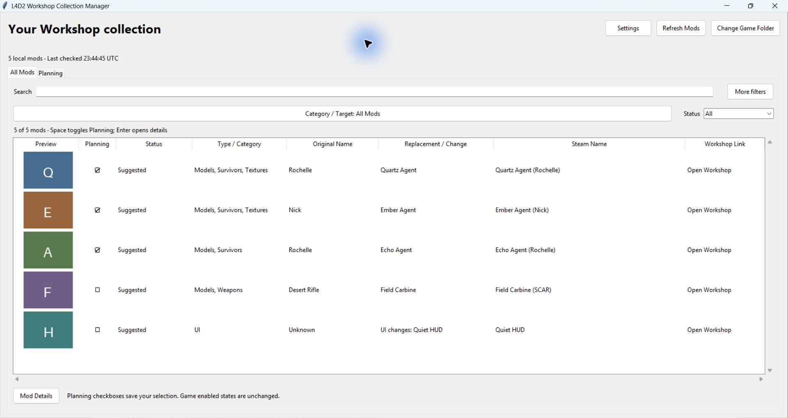
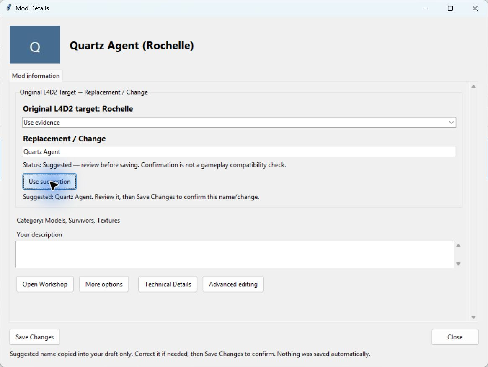
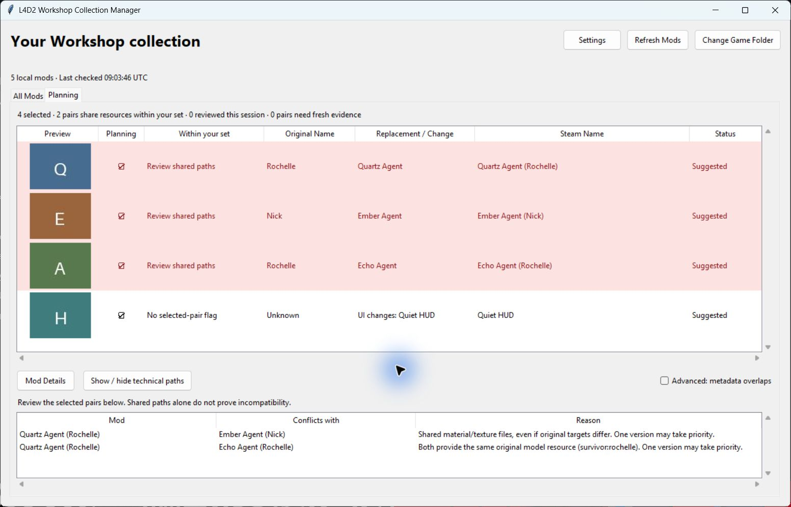

# L4D2 Workshop Collection Manager

See what your installed Left 4 Dead 2 Workshop mods change, correct missing names,
and review potential resource conflicts in a saved Planning set.

**M6.4 / 0.1.0rc4 pre-release — awaiting owner approval. No public release has been
published yet.** Windows x64 portable build; no Python or SQLite installation
required for players. This independent project is not affiliated with Valve.

## What it does

- Lists locally available Workshop packages with previews, official public Steam
  titles, categories/tags, links and Original Target → Replacement / Change.
- Provides a single Category / Target chooser: Survivors → Rochelle, or Weapons
  → Rifles → Desert Rifle, with broad category choices too.
- Offers conservative replacement suggestions, clear review status and manual
  corrections. Unknown information stays unknown until supported or corrected.
- Keeps one Planning set and explains selected-pair overlaps as **Mod | Conflicts
  with | Reason**, with optional technical evidence.
- Remembers your game folder, corrections and Planning selection across restarts.
- Works with cached information offline; public Steam metadata updates in the
  background when due and can be disabled in Settings.

**Your game installation stays read-only.** The app does not enable/disable addons,
edit addonlist, change load order, subscribe/unsubscribe, download VPKs or run L4D2.

## Screenshots

The screenshots below use fictional demonstration data and generated letter
thumbnails. They contain no real Workshop artwork or personal catalog data.

## Download and start

When the owner publishes a release, open its GitHub **Releases → Assets** and choose
`L4D2ModDatabase-0.1.0rc4-win-x64.zip`. A public repository/download URL will be added
after publication is approved. The source-code archive is for developers.

1. Extract the **entire ZIP** to an ordinary writable local folder.
2. Open **L4D2ModDatabase.exe**. Keep its `_internal` folder beside it.
3. On first launch, select the **Left 4 Dead 2 game root**, containing `left4dead2`.
4. Let the local catalog load. Later launches reopen the saved folder automatically.

Intended platform: Windows 10/11 x64. No administrator rights are needed for normal
use. Testing does not cover every Windows version or Steam setup. The EXE is
unsigned, so Windows may display ordinary reputation/trust warnings. Verify the
source and SHA256; do not disable antivirus or system security globally.

## All Mods

Use Search for titles, targets or your custom names. Open **Category / Target**,
expand a category and select a target, or choose the category's All option. Select
**All Mods** to clear this filter. Tags and local/user target evidence contribute
to discoverability but remain separate sources in Details; a Steam tag alone does
not prove the actual original target. Multi-category mods can appear in several
appropriate places. Unsupported/ambiguous targets remain Unknown.

Status means:

| Status | Meaning |
|---|---|
| Confirmed | A replacement/change name was saved by you; other information may still need review |
| Suggested | An unconfirmed suggestion based on supported local evidence and cached public metadata |
| Needs Review | Some information remains unknown or unconfirmed |
| Stale | File or classification evidence needs checking; retained names are not erased |

Confirmation does not certify gameplay compatibility. Hover truncated text for
full values/provenance. A missing, corrupt or oversized preview uses a placeholder
and does not prevent catalog use. **Refresh Mods** checks local Workshop changes.
Steam/game synchronization can take time after subscription; an absent VPK does
not prove unsubscription or that a download completed.

## Correct a mod's information

Open **Mod Details**. The Steam title/preview and **Original L4D2 Target →
Replacement / Change** are prominent. Use a suggestion where available, correct
the replacement/change and add your description, then **Save Changes**.

For multiple supported targets, choose the target by its friendly name. Technical
effect/component editing remains optional. **More options → Custom catalog name**
is a separate convenience name: it does not change the replacement or official
Steam title. It is searchable and used in local names/fallbacks and preview hover.
Expanding/collapsing options does not discard drafts. Navigation/closing protects
unsaved edits; refresh keeps drafts tied to the evidence revision you reviewed.

## Planning and warnings

Check Planning boxes to build one persistent set. This selection is for analysis;
it does not change which mods L4D2 has enabled. Read **Mod | Conflicts with | Reason**
for pairs where **both** packages are selected. Mods outside the set do not cause
selected-pair warnings. Technical paths and common metadata overlaps are optional.
Mods in current selected resource-overlap pairs have a pale red row. Other mods
stay normal; stale findings still ask for fresh evidence. Red means review the
overlap, not that a crash has been proven. Marking reviewed keeps the highlight.

Same original model resources can mean replacement competition. Different survivor
or weapon targets can still share materials, sound, UI or scripts. One resource
version may take priority, but exact path equality does **not** prove a crash or
incompatibility. No exact overlap does **not** prove full compatibility either.
Crash evidence defaults to **Not verified**. Stale/incomplete coverage is visible;
review marks do not erase evidence. See [what warnings mean](docs/CONFLICTS.md).

## Privacy and saved data

Data is stored in `%LOCALAPPDATA%\L4D2ModDatabase`, including the catalog,
preferences, edits, Planning selection, metadata cache and migration backups.
Moving the portable app does not move/delete this data. Source and EXE launches
share the same normal user data. The game remains read-only.

Public metadata requests send only validated numeric IDs from your selected local
collection to the fixed Steam HTTPS API, with no login or private subscription
access. Titles/tags/descriptions are cached separately from your corrections.
Success cache: 24 hours; error retry: 15 minutes; rate limiting: one hour. Settings
can disable automatic lookups or retry due items. Offline failures retain valid
caches. Workshop links open only on a click. No telemetry/project server exists.
Read the [privacy details](docs/PRIVACY.md).

## Troubleshooting

- **Wrong/moved/unavailable game folder:** use Change Game Folder. Previously valid
  catalog data is retained; reconnect/reselect and Refresh Mods when available.
- **Fewer mods than subscriptions:** allow Steam/L4D2 Workshop synchronization to
  finish, then refresh. Matching counts do not prove identical subscription IDs.
- **Steam info unavailable:** cached names remain. Check Settings, internet and the
  retry delay. Deleted/private/inaccessible items may not return public metadata.
- **Unknown replacement:** review/enter a correction. Component-only or mixed mods
  may have change descriptions instead of one character/weapon identity.
- **Stale/corrupt/pending file:** inspect its status/technical evidence. The app
  retains last-valid evidence instead of declaring a misleading all-clear.
  A file with no indexed change keeps replacement editing disabled until recovery;
  your description and optional catalog name can still be saved.
- **EXE cannot find runtime files:** extract the whole ZIP; keep `_internal` beside
  the EXE. Do not copy only the executable.
- **Saved-name conflict after an update:** refresh, inspect the changed source and
  confirm again. Old valid edits are not silently overwritten.

To report a bug after publication, use the repository's issue template with the
version, Windows version, reproducible steps and expected/actual behavior. Redact
personal paths/account data. Do not upload catalogs, credentials or Workshop VPKs.

## Limits and future work

No Game Active synchronization, enabled-state editing, subscription management,
multiple planning sets, load-order editor or crash predictor. Classification is
conservative; description-based identity inference and unsupported exact targets
remain for later work. Payload equality, model internals, script execution,
semantic/dependency incompatibilities and multiplayer server policy are not fully
evaluated. Engine path-comparison semantics and live VPK v2 coverage remain limited.
See the [post-release backlog](POST_RELEASE_BACKLOG.md).

One external closed-beta tester was reported by the owner to have launched M6.3
and detected their collection on another device. This does not certify all Windows
setups or the final M6.4 binary. The [beta checklist](docs/BETA_CHECKLIST.md) separates
launch/detection evidence from further acceptance testing.

## Developers and licensing

Use [the developer guide](docs/DEVELOPMENT.md) for source setup, tests, SQLite design
and build commands. `Start-Alpha.cmd` remains the development launcher from a full
source checkout. Portable releases bundle their runtime.

Original project source and documentation are licensed under the [MIT License](LICENSE).
Copyright (c) 2026 RABrian. Runtime libraries retain their own licenses/notices.
Steam data, game names and Workshop assets are not relicensed.
See [licensing](docs/LICENSING.md), [release preparation](docs/RELEASING.md) and
[draft release notes](RELEASE_NOTES.md). Nothing has been published automatically.
