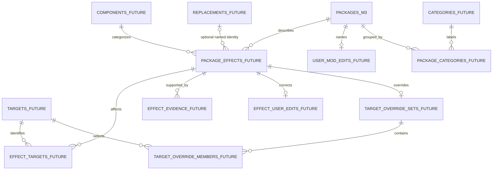

# Future UI data presentation contract — design only

> Historical M3 design reference (October 2026). This document preserves the original design requirements and examples; it is not a description of every feature in the M6.4 release. For current behavior, see [README.md](README.md) and the [developer guide](docs/DEVELOPMENT.md).

Prepared 26 October 2026. This document records the owner's additional product
requirement. **It does not authorize a GUI, classification engine, metadata
fetcher, conflict engine or extra M3 tables.** M3 remains the seven-table catalog
foundation. Revision 2 was approved and M3 implemented on 29 October 2026;
this UI contract is mandatory for future work, without authorizing that work now.

All examples below are fictional. A/B/D/E/F refer to the synthetic package UUIDs
in [M3_SAMPLE_DATA.md](M3_SAMPLE_DATA.md). C is confirmed removed and is deliberately
excluded from the default All Mods catalog. Friendly names, target assignments,
replacement identities and verification states below illustrate future enrichment;
they are **not facts discoverable from the M3 sample rows alone**.

## 1. Required user-facing distinction

The main catalog must explain **what original L4D2 target/component changes and
what the installed addon replaces or modifies it with**. It must not require
knowledge of internal VPK paths to answer that question.

Three distinct facts must stay separate:

| Fact | Fictional example | What supports it |
| --- | --- | --- |
| Original game target | AK-47, canonical game identifier `rifle_ak47` | Reviewed target reference plus trustworthy evidence or an explicit user correction |
| Replacement identity | M4A1 Carbine | Source metadata or user identification; a directory path alone does not identify its model geometry |
| Internal resource evidence | `models/weapons/v_rifle_ak47.mdl` | Byte-preserving scanned asset listing |

The title "M4A1 Carbine" does not mean the original target is an M4/M16 slot.
Never infer an original slot from the replacement's real-world weapon name.
Preserve advertised source wording separately from inferred and user-confirmed
values. Classification confidence and parser/index success are different states.

`rifle_ak47` is the game identifier supplied in the owner's example. Other
example app IDs such as `survivor:rochelle` or `component:team_hud` below are
**proposed internal reference keys**, not claims of verified engine class names.
Show the canonical game identifier as `Unknown` until the reference mapping is
verified. Internal app keys must never masquerade as game identifiers.

One package may contain multiple effects, each with its own original targets,
replacement/description, component and evidence. A UI/sound-only addon need not
replace any character/weapon model. Unknown originals or replacements remain
`Unknown`/`Needs Review`; do not manufacture a complete pair for every addon.

## 2. Proposed All Mods layout

Priority order for a row/card:

1. Local Workshop thumbnail or neutral fallback.
2. Friendly name; source title and filename are secondary identification.
3. Original target label and **verified canonical game identifier**, when known.
4. Replacement name or component-change description, per effect.
5. Categories and affected components, supporting multiple values.
6. Classification/review status with reason, distinct from index availability.
7. Optional Details action for source provenance and technical asset paths.

Suggested readable row structure, without selecting a UI toolkit:

```text
[thumbnail] Field Kit: M4A1              Model verified · other effects need review
            Original: AK-47 [rifle_ak47]
            Replacement: M4A1 Carbine
            Weapon · model + materials
            [Details]   Source title / Workshop ID available as secondary text
```

Multiple effects expand into short original → replacement/component summaries,
not a misleading single pair or an unreadable list of asset paths. Provide
accessible text/icon labels in addition to color. Keep technical paths out of
the primary identification flow.

### Five fictional catalog records

The synthetic metadata names below are teaching labels, not real Workshop titles.
Sample preview paths are references only; no images have been generated/read.

| Sample package | Thumbnail | Friendly name | Original target / game identifier | Replacement or change | Category / components | Classification and index state |
| --- | --- | --- | --- | --- | --- | --- |
| A | Local `9100001001.jpg` | Field Kit: M4A1 | AK-47 / `rifle_ak47` | M4A1 Carbine | Weapon; model + materials | Model: fictional future User Verified at generation 2; shared material scope: Needs Review; index current |
| B | Local `9100001002.jpg` | Lunar Medic | Previously identified as Rochelle / game ID Unknown pending reference validation | Previously advertised Custom Survivor Character; fictional name "Lunar Medic" | Survivor; model + voice resources | Needs Review: corrupt update; only generation-1 evidence remains. Do not claim its current bytes implement the previous replacement |
| D | Neutral fallback | Unidentified Workshop package | Unknown | Unknown | Unknown | Needs Review; file pending, no valid index and no inferred Workshop ID |
| E | Local `9100001004.jpg` | Squad Remix | Two groups: AK-47 / `rifle_ak47`; Rochelle / game ID Unknown | Prototype Rifle; Custom Survivor Character; shared material scope unresolved | Weapon + survivor; models + shared materials | Needs Review: two fictional effect assignments plus an unattributed shared component; index current |
| F | Local `9100001005.jpg` | Team Signals | Team notifications and HUD components / game IDs Unknown | Fictional user description: softer notice tones and a cool-color panel scheme | Sound + UI; no asserted weapon/character model replacement | Component scope described by fictional user input; identity/engine reference still Needs Review; index current |

Rules illustrated by these rows:

- A's replacement identity is a fictional future manual verification, not an
  inference that M2/M3 can make from `v_Rifle_AK47.mdl`.
- B's raw non-UTF-8 voice path stays byte-preserved. Its source encoding is not
  guessed, and the raw filename is not presented as a replacement character name.
- D's nonnumeric filename does not become a fabricated Workshop item or title.
- E has several effects. Any package-level summary must retain per-effect
  confidence rather than label all its contents verified.
- F has component descriptions without forcing a weapon/survivor replacement pair.

All Mods has **no general conflict-red highlighting**. It may show neutral/amber
text or icons for unavailable data, corrupt archives and review work. Exact
overlap warnings may be inspected in Details as evidence, but contextual conflict
highlighting belongs only to Planning and Game Active.

Removed C is not a normal installed catalog row. If later history management is
designed, it must label C inactive and preserve its old UUID; it must not present
retained source data as still installed.

## 3. Mod Details view

The fictional A record illustrates a complete future presentation:

| Section / field | Proposed displayed value | Provenance / behavior |
| --- | --- | --- |
| Friendly name | Field Kit: M4A1 | Future user edit, separate from original title |
| Original source title | "M4A1 Carbine Workshop Pack" | Fictional future metadata observation; source and observation timestamp visible |
| Source filename / inferred ID | `9100001001.VPK` / `9100001001` | Existing discovery facts; ID still inferred, not subscription verification |
| Index availability | Current; last valid generation 2 | Proposed M3 persisted state; current means current as observed, not game-runtime verification |
| Original target | AK-47 | Fictional future reviewed target assignment |
| Canonical game identifier | `rifle_ak47` | Requires validated target reference before production display as fact |
| Replacement identity | M4A1 Carbine | Fictional future user identification; source title alone would be only an advertised hint |
| Affected components | Model; materials | Future effect interpretation supported by resource evidence |
| Confidence | User Verified for the named model effect | User verification source/time and basis generation 2 are shown |
| Evidence | Model path and explicit user verification | Asset existence supports a resource observation; it does not independently prove replacement geometry |
| Shared material scope | Needs Review | A material path can be present without every affected target being known |
| User correction | Edit friendly name, replacement identity, target assignments or description | Future app-data writes only; original scan/source observations remain available |

Technical drawer:

| Internal resource evidence | Canonical comparison form | Interpretation boundary |
| --- | --- | --- |
| `Models/Weapons/v_Rifle_AK47.mdl` | `models/weapons/v_rifle_ak47.mdl` | Possible original-slot evidence only after rule/reference verification |
| `Materials/Shared/Finish.vmt` | `materials/shared/finish.vmt` | Shared resource; path alone does not establish every target or the replacement's name |

Also show the parser version, canonicalization-policy version, source/index
timestamps, declared entry sizes/CRC and safe diagnostics when requested. CRC is
declared metadata, not a passed integrity check. Byte paths can be inspected as
escaped display plus hex; never replace undecodable bytes or require reading hex
to identify a mod's ordinary intended effect.

For B, show a prominent **Last valid evidence retained; current update unreadable**
message. Previous user text and observed source metadata survive. Verification
trust does not survive automatically: display prior claims as historical and the
current package as Needs Review. Do not silently show stale fields as current facts.

For multi-effect E, render an effect table such as:

| Effect | Original(s) | Replacement/change | Evidence and review |
| --- | --- | --- | --- |
| Weapon model | AK-47 | Prototype Rifle | Fictional target evidence; advertised replacement needs confirmation |
| Survivor model | Rochelle | Custom Survivor Character | Separate evidence and reference-ID review |
| Shared material | Unknown affected targets | Shared finish material change | Needs Review; do not attach it automatically to both preceding targets |

## 4. Planning and Game Active

Both views reference the **same package UUIDs, effective presentation fields and
source evidence** as All Mods. Do not duplicate catalog rows into separate profiles.

| Context | Selection source | Presentation and conflict behavior |
| --- | --- | --- |
| All Mods | All nonremoved/provisionally retained packages | Understandable target/replacement summaries; no general conflict-red styling |
| Planning | One future saved planning set | Checkboxes change app selections only. Warn on selected conflicts and on unselected candidates that overlap selected packages |
| Game Active | Last successfully read saved addon configuration | Show snapshot timestamp, freshness, enabled mapping and unmatched entries. Highlight overlaps among mapped enabled packages only; do not claim verified live runtime state |

Fictional future example: selecting A in Planning can flag unselected E because
their retained current sample listings share model/material keys. Show package
pair and shared path evidence only after the later conflict engine performs the
comparison; this document does not compute or implement that feature. The warning
means observed resource overlap, not proof of a crash. Different original targets
can still share a resource.

Stale/unavailable indexes must not produce a false claim of current compatibility
or freshly confirmed overlap. Distinguish last-known evidence and unknown coverage.
Game Active must separately represent stale/unavailable configuration, unmatched
entries and removed files. Conflict indicators use text/icons and accessible
colors; only Planning/Game Active use contextual red highlighting.

Confirmed removal will later delete that UUID's planning membership in the same
catalog transaction; uncertainty preserves it provisionally. A new package UUID
after later reappearance receives no automatic selection or inherited user edits.

## 5. Logical data model required by the future presentation

**No tables in this section are added to the M3 DDL.** These are normalized future
requirements to be reviewed during their own milestones. They extend the earlier
coarse package/target outline because one replacement pair per package cannot
represent E or F accurately.



| Future table/concept | Keys and relationships | Purpose / normalization |
| --- | --- | --- |
| `targets` | `target_id` PK; family, label, nullable canonical game identifier and reference status | Original target dictionary; internal app key is distinct from engine identifier. Aliases belong in a child `target_aliases` table |
| `components` | `component_id` PK; label | Reusable model/material/sound/script/UI component types |
| `replacements` | `replacement_id` PK; name, kind | Optional identified replacement character/model identity, separate from the original target. Unknown is SQL NULL, not a fabricated dictionary entry |
| `package_effects` | `effect_id` PK; package FK, component FK, nullable automatic replacement FK, automatic description/status | Multiple effects per package. Different replacements/components use distinct effect rows |
| `effect_targets` | Composite PK/FKs `(effect_id,target_id)` | M:N junction: one effect can affect several originals; no target rows means unknown/unassigned, not assumed global scope |
| `effect_evidence` | Evidence PK; effect FK; source/rule, reasoning/confidence, basis index generation, optional original path BLOB or metadata-observation FK | Multiple independent reasons per effect. Keep source version/provenance and preserve bytes. Generation is an evidence version tag, not a dangling FK to a superseded index |
| `categories`, `package_categories` | Category PK; junction PK/FKs `(package_id,category_id)` | Multiple package groups instead of a CSV field or one forced category. Provenance for automatic assignments remains separate evidence |
| `user_mod_edits` | Package PK/FK; friendly name, user description, review information | Optional 1:1 user layer. No edits to source title or scanned assets |
| `effect_user_edits` | Effect PK/FK; optional replacement/description correction, review source/time, basis generation | Effect-level user correction. An explicit mode distinguishes inherit, assigned value and deliberately unknown |
| `target_override_sets`, `target_override_members` | One set PK/FK per effect plus member PK/FKs `(effect_id,target_id)` | Explicit inherit/replace/unknown modes distinguish "no override" from "user says target unknown"; no comma-separated target list |
| Future Workshop metadata observations | Observation PK; Workshop-item FK; source title/description, provenance and timestamp | Preserve advertised wording and history separately from effective user names. Remote acquisition needs a separately reviewed opt-in policy |
| Future bounded addon metadata observations | Observation PK; package FK, basis generation, source path bytes and metadata | Local addon title is not automatically a Workshop web title. Not parsed in M2/M3 |

Future effect IDs must remain stable only when an effect can be matched reliably
across reclassification. If an effect is split/removed or ambiguous after an
update, retain affected user corrections as inactive/Needs Review records rather
than cascading them away or copying them onto unrelated new effects. Details of
that reconciliation belong to the classification/editing milestone.

Effective values follow explicit precedence: user correction when present,
otherwise supported automatic inference, otherwise Unknown. Advertised wording
remains labelled as an advertised claim. A stale basis generation downgrades
trust/review state while preserving the user value and raw evidence. Package-wide
review summaries aggregate per-effect states without erasing mixed confidence.

Future planning tables remain `planning_sets` plus `planning_members`, separate
from effects and metadata. Game-state snapshots/entries remain a later feature.
For the initial single same-ID JPG, proposed M3 preview fields suffice as a
reference; a new media table is unnecessary until reviewed requirements demand
multiple sources/images. Future image reads/decoding must be bounded and scoped;
cached assets would stay in designated app data, never arbitrary paths.

## 6. Availability by milestone and source

The following availability matrix originated in the pre-implementation review.
M3 is now implemented; its proposed persistence column describes the delivered
foundation. All later sources/features remain unimplemented.

| Data field | Available after M2 now? | Proposed after approved M3 | Later source/work |
| --- | --- | --- | --- |
| Physical filename/location, inferred ID | Yes, in-memory | Persisted in packages/item registry | Does not prove subscription identities |
| Local JPG reference/availability | Reference only; no image decode | Persisted reference/status | Thumbnail rendering and guarded JPG content reads are later work |
| Original/canonical asset bytes, declared metadata | Yes, bounded index | Byte-safe BLOB rows | Engine comparison semantics still unverified |
| Current/last-valid index and errors | RAM-only | Durable latest valid data and semantic scan audit | UI freshness must separate live polling from last durable batch |
| Workshop web title/description | No | No | Future explicit metadata source or user input; remote enrichment is not required |
| Local addon title/description | Not parsed | Not added by M3 | Future bounded metadata reader and provenance |
| Friendly display name | Filename/ID fallback only | Same fallback; no user-edit tables yet | Future user edit or qualified metadata-derived display name |
| Original target/canonical game identifier | No classification | Not created by M3 ingestion | Reviewed reference mappings, evidence rules, or explicit user correction |
| Replacement identity/description | No reliable identity inference | Not created by M3 ingestion | Qualified metadata or future user input; directory names alone are insufficient |
| Categories/effects/confidence/review | No classification engine | Not created by M3 | Future classification and separate overrides/evidence |
| Planning selection/overlap explanation | No | No | Later planning membership and conflict engine |
| Saved Game Active status | No | No | Later bounded addonlist reader, mapping and snapshot timestamps |

M3 UI examples therefore cannot be advertised as outputs already generated by
M3. A future UI using only unclassified M3 data must show Unknown/Needs Review for
target/replacement fields and may offer technical evidence as optional detail.

## 7. Future acceptance criteria

- A user can identify an addon’s original target/component and qualified
  replacement/description without interpreting a VPK resource path.
- A title naming an M4A1 never automatically turns its original target into M16.
- Multi-target, component-only, unknown and stale/corrupt cases remain intelligible.
- User correction never overwrites raw scanned bytes or source metadata.
- Every classification shows provenance and review state, independently of index
  success; no arbitrary certainty percentages or invented names.
- Canonical engine identifiers are shown only after reference verification;
  proposed internal app keys stay clearly distinguished.
- All Mods avoids general conflict-red styling. Planning/Game Active warnings
  name their selection context, evidence and freshness without claiming crashes.
- Confirmed-removal/reappearance behavior preserves history without resurrecting
  old selections or silently transferring user verification.

This is a future presentation/data contract, **not M3 implementation permission**.
